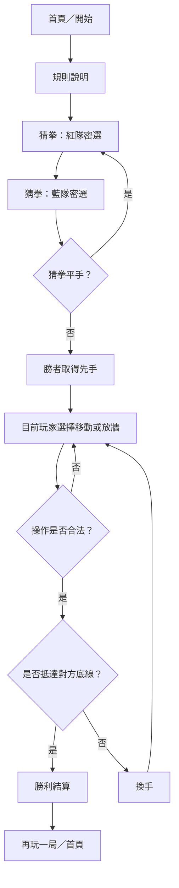

# Wall Rush｜突破防線 — Claude Code 開發說明書

> **文件版本：V1.2（整合版）**  
> **更新日期：2026-11-14**  
> **文件用途：交付 Claude Code 進行網頁遊戲開發、測試及驗收**  
> **版本優先原則：本文件 V1.2 取代舊版 7×7、單格牆及禁止跳躍的描述。**

---

## 1. 專案定位

- **專案名稱**：Wall Rush｜突破防線（名稱暫定，可更名）
- **遊戲類型**：雙人、回合制、競速與阻擋策略棋盤遊戲
- **核心目標**：玩家操作自己的球前往對方底線，並利用有限的牆阻礙對手；先抵達對方底線者獲勝。
- **第一版遊玩方式（建議方案）**：同一台電腦／裝置，由紅、藍玩家輪流操作（本機雙人）。此為技術實作預設，非使用者明確指定的唯一模式。
- **目標平台**：Windows 桌面瀏覽器優先，並支援手機及平板響應式介面。
- **第一版原則**：先完成規則正確、可完整遊玩、好操作的 MVP；不預先加入 AI 對手、帳號、伺服器、排行榜或跨裝置即時對戰。

## 2. 規則確認紀錄與優先級

### 2.1 使用者已確認（必須實作）

| 項目 | V1.2 正式規則 |
|---|---|
| 棋盤 | **8×8，共 64 格**（由 7×7 修改） |
| 玩家 | 紅隊、藍隊，各有一顆球 |
| 牆數 | 每位玩家 **10 道** |
| 牆長 | 每道牆連續占用 **兩個相鄰格邊**（由單格邊修改） |
| 勝利 | 率先移動至對方後方的整條底線，即獲勝 |
| 一般移動 | 球一次走一格；雙方輪流操作 |
| 跳躍 | **允許直線跳過相鄰的對手球，落到其正後方一格** |
| 側跳 | **不允許**。直線跳躍遭牆或棋盤邊界阻擋時，不能側跳 |
| 放牆限制 | 牆只能抵擋行進；不可完全封鎖任一方通往終點的所有路線 |
| 先手 | 猜拳決定：剪刀／石頭／布 |
| 猜拳倒數 | 每名玩家有 **10 秒**選擇 |
| 揭曉 | 兩位玩家均完成選擇後，才同時公開答案；勝者先手 |

### 2.2 為使程式可執行而採用的建議預設值（可再調整）

| 問題 | V1.2 開發預設 | 理由／狀態 |
|---|---|---|
| 8 欄沒有唯一中央格 | 紅球起點 **(8,4)**，藍球起點 **(1,4)**；座標使用**第 1 列～第 8 列、第 1 欄～第 8 欄** | 延續前次對話已建議的對稱起點；如使用者之後指定第 5 欄，僅改設定 |
| 球的前進方向 | 紅隊朝第 1 列；藍隊朝第 8 列 | 延續已討論勝利條件 |
| 抵達終點 | 紅球進第 1 列**任意格**，或藍球進第 8 列**任意格**，即立即勝利 | 將「後面的那條線」具體化 |
| 一回合行動 | **移動一次（一般移動或直線跳躍），或放一面牆，二擇一** | 避免同回合移動加放牆 |
| 一般移動方向 | 上、下、左、右，不可斜走 | 易懂且能明確受牆阻擋 |
| 兩球同格 | 禁止 | 對手占據的相鄰格不能以一般移動進入 |
| 牆重疊／交叉 | 禁止重疊或在同一個交點交叉 | 兩格牆的幾何與策略規則 |
| 猜拳平手 | 重新猜拳直到有勝者 | 確保先手唯一 |
| 猜拳逾時 | 該玩家由系統隨機代選剪刀／石頭／布 | 避免無限等待 |
| 放牆確認 | 預覽→確認→正式放置並扣一面牆 | 降低失誤 |
| 未合法放牆 | 不扣牆、不換回合 | 避免誤觸受罰 |
| 同機猜拳 | 紅方先密選、換藍方密選，兩方結束後同時揭曉 | 減少偷看到對方選擇 |
| 牆用完 | 玩家仍可正常移動，但不能再放牆 | 確保對局可繼續 |

> **關鍵提醒**：第 2.2 節屬「建議／技術預設」，不是全部都由使用者明確指定。若後續確認不同答案，僅修改相應規則與測試，不應擅自覆蓋第 2.1 節已確認內容。

## 3. 棋盤、座標與獲勝判定

### 3.1 棋盤

- `BOARD_SIZE = 8`。
- 列由上至下 1～8，欄由左至右 1～8。
- 紅球預設在 (8,4)；藍球預設在 (1,4)。
- **紅隊目標列 = 第 1 列**；**藍隊目標列 = 第 8 列**。
- 球一旦完成合法移動並位於自己的目標列，立即進入 `gameOver`，不得再允許額外行動。

### 3.2 示意（R = 紅、B = 藍）

```text
      欄 1  2  3  4  5  6  7  8
列 1     .  .  .  B  .  .  .  .   ← 紅隊要抵達此列
列 2     .  .  .  .  .  .  .  .
列 3     .  .  .  .  .  .  .  .
列 4     .  .  .  .  .  .  .  .
列 5     .  .  .  .  .  .  .  .
列 6     .  .  .  .  .  .  .  .
列 7     .  .  .  .  .  .  .  .
列 8     .  .  .  R  .  .  .  .   ← 藍隊要抵達此列
```

## 4. 回合與移動規則

### 4.1 每回合只能選擇一項

1. **移動球**：一般移動一格，或符合條件時執行一次直線跳躍。
2. **放置一道牆**：成功放置後剩餘牆數減一。

完成合法操作後切換至另一隊；非法操作不會消耗行動，也不換手。

### 4.2 一般移動

- 僅四個正交方向：上、下、左、右。
- 不可出界、穿越牆或進入對方球所在格。
- 點擊自己的球時，高亮所有合法移動終點。

### 4.3 直線跳躍（已確認 V1.1，V1.2 延用）

若相鄰格是對方球，可以沿相同方向再前進一格，**越過對手球**，前提是：

1. 自己與對手位於同一直線的相鄰兩格。
2. 自己與對手之間**無牆**。
3. 對手正後方一格仍在棋盤內。
4. 對手與後方落點之間**無牆**。
5. 落點可合法停留。

符合全部條件時，將跳躍落點標示為合法位置；跳躍算**一次移動、一個回合**。

**嚴格禁止側跳**：若正後方是牆或棋盤外，即使對手左右兩側有空格，也不能側跳；不允許斜向跳躍。

```text
合法：           禁止：
[落點]           [牆／棋盤邊界]
[藍球]           [藍球]
[紅球]           [紅球]
紅球跳兩格       不可改跳對手左／右方
```

## 5. 兩格長牆：規則、表示法與合法性

### 5.1 牆的幾何定義

- **每面牆占用兩段連續、共線的格邊**，水平／垂直皆可。
- 牆置於相鄰方格之間的縫隙，不能放在棋盤外框。
- 每面牆必須完整占用兩段邊；不可半截出界。
- 不可與既有牆占用相同格邊（重疊）。
- **預設不允許垂直牆與水平牆於各自中點交叉**；相鄰牆合法端點接觸則允許，只要未重疊、未形成禁止的交叉且未封路。
- 在 8×8 棋盤上，兩格長牆的水平與垂直合法候選位置，未計占用限制前各為 `(8-1)×(8-1)=49` 個，共 **98 個候選牆位**。

### 5.2 建議標準化模型

使用**0-based 內部索引**（UI 可顯示 1-based）：

```ts
type PlayerId = 'red' | 'blue';
type Position = { row: number; col: number }; // 0..7

type Wall = {
  id: string;
  owner: PlayerId;
  orientation: 'H' | 'V';
  anchorRow: number; // 0..6
  anchorCol: number; // 0..6
};
```

`Wall` 的 anchor 指向 2×2 方格區塊的左上角：

- `H(r,c)` 封住 `(r,c)↔(r+1,c)` 與 `(r,c+1)↔(r+1,c+1)` 兩段邊。
- `V(r,c)` 封住 `(r,c)↔(r,c+1)` 與 `(r+1,c)↔(r+1,c+1)` 兩段邊。

**請設計唯一的 `isEdgeBlocked(a,b,walls)` 作為所有移動／跳躍／路徑搜尋的共用判定**，避免三套邏輯出現矛盾。

### 5.3 放牆檢查程序

1. 檢查目前玩家是否仍有牆。
2. 檢查候選牆位的方向與 anchor 是否在有效範圍。
3. 檢查兩段格邊是否與既有牆重疊。
4. 檢查是否與既有相反方向牆於相同 anchor 交叉。
5. **暫時加入**候選牆，不先寫入正式遊戲狀態。
6. 重新計算紅隊與藍隊是否都仍有到自己目標列的可達路徑。
7. 兩隊都有路：允許確認放置；任何一方無路：拒絕並保留回合、牆數。

### 5.4 「不能完全封路」之精確判定

- 以 BFS（或等效正確路徑演算法）檢查 **紅隊目前格 → 第 1 列任一格**，以及 **藍隊目前格 → 第 8 列任一格**。
- BFS 應考慮棋盤邊界及所有牆，但為判斷**長期仍有一條路**，**不把對方球視為永久障礙物**；雙方球的位置會移動，否則可能錯誤拒絕合法牆。
- 此 BFS 是放牆合法性的「幾何可達性」檢查，**不等於**實際當回合可移動格的計算。實際移動仍需考慮對方球及跳躍條件。
- 禁止直接用「終點列有沒有被牆封住」代替完整可達性判定。

非法放牆文案：「此位置會完全封鎖通往終點的路徑，不能放置。」

## 6. 猜拳決定先手

### 6.1 順序與隱私

1. 遊戲首頁點選「開始遊戲」，顯示快速規則後進入猜拳。
2. 紅隊有 **10 秒**選擇剪刀／石頭／布；選定後鎖定並隱藏答案。
3. 顯示「請將畫面交給藍隊」，藍隊點擊「我準備好了」後才開始其 10 秒。
4. 藍隊選定後鎖定答案。
5. **雙方均選定（含逾時自動代選）後，才同時揭曉**兩者選項。
6. 勝者成為第一回合玩家；平手則重新猜拳。

> 紅、藍依序密選是「同機雙人」的介面預設，**不是**更改原本「雙方都選好才揭曉」的規則。請避免在選擇期間顯示對方答案。

### 6.2 逾時與邊界

- 每位玩家計時 10 秒。
- 時間到仍未選：由系統從三選項中**隨機代選**，顯示逾時提示。
- 揭曉前不得提前展示任何人的選擇。
- 平手立即開啟新一輪猜拳，並重置兩位玩家的選擇與倒數。
- 預設猜拳選擇按下即鎖定，不得再次更改。

## 7. 畫面、操作流程及視覺設計

### 7.1 頁面結構

1. **首頁**：遊戲名稱、開始遊戲、規則說明、音效開關。
2. **規則快速說明**：8×8、各 10 道兩格牆、移動與直線跳躍、禁止封路、抵達底線即勝利。
3. **猜拳頁**：隊伍識別、三個選項、10 秒倒數、保密換手、揭曉、平手重來。
4. **主棋盤頁**：8×8 棋盤、紅藍球、兩格牆、兩側隊伍資訊、目前回合、移動／放牆模式、剩餘牆數、回合數。
5. **結果頁**：勝利隊伍、簡短勝利動畫、「再玩一局」、「返回首頁」。

### 7.2 典型操作循環



### 7.3 視覺風格

- **主題**：「未來競技桌遊」，避免單純試算表風格。
- **底色**：深灰／深色；棋盤具有微弱立體層次、清楚格線與細緻光暈。
- **紅隊**：珊瑚紅／橘紅；**藍隊**：科技藍／冰藍。
- **目標列**：第 1 列為紅隊目標，使用淡紅提示；第 8 列為藍隊目標，使用淡藍提示。注意球初始所屬顏色與目標提示色不同，避免混淆。
- **可移動提示**：選球後高亮合法目標格；直線跳躍落點亦需正確顯示。
- **放牆預覽**：滑鼠 hover 及觸控選擇時顯示整道**兩格長**的半透明牆，合法與非法採不同顏色；點擊後進入確認。
- **互動回饋**：球移動、換手、放牆、猜拳揭曉、非法動作與勝利動畫；提供音效開關，避免音效強制播放。
- **適應尺寸**：桌面顯示兩側隊伍面板，手機轉為上下排列並保證格線及牆的位置可點選。支援滑鼠、觸控及適當的鍵盤操作。
- **狀態處理**：操作確認／取消、無牆可放、非法位置、猜拳倒數、平手、勝負完成等都應提供清楚提示。

## 8. 資料結構與遊戲狀態

```ts
type PlayerId = 'red' | 'blue';
type RpsChoice = 'rock' | 'paper' | 'scissors';
type GamePhase = 'menu' | 'rules' | 'rps' | 'playing' | 'gameOver';

type Position = { row: number; col: number }; // 0-based，0..7

type PlayerState = {
  position: Position;
  wallsRemaining: number;
};

type Wall = {
  id: string;
  owner: PlayerId;
  orientation: 'H' | 'V';
  anchorRow: number; // 0..6
  anchorCol: number; // 0..6
};

type GameState = {
  phase: GamePhase;
  currentPlayer: PlayerId | null;
  players: Record<PlayerId, PlayerState>;
  walls: Wall[];
  turnNumber: number;
  winner: PlayerId | null;
  selectedAction: 'move' | 'wall' | null;
  pendingWall: Omit<Wall, 'id' | 'owner'> | null;
  rps: {
    round: number;
    stage: 'redPick' | 'passToBlue' | 'bluePick' | 'reveal';
    redChoice: RpsChoice | null;
    blueChoice: RpsChoice | null;
    secondsLeft: number;
  };
};
```

建議把 `BOARD_SIZE`、`INITIAL_WALLS`、`RPS_TIME_LIMIT_SECONDS`、起點、目標列放在集中設定檔，避免硬編碼散落。

## 9. 技術架構與執行方式

| 項目 | 建議 |
|---|---|
| 前端 | React + TypeScript + Vite |
| 畫面 | CSS（可使用 CSS Grid、SVG 輔助呈現牆位置） |
| 遊戲規則 | TypeScript 純函式模組，避免規則與 UI 混寫 |
| 狀態 | React state／reducer（規模足夠，不必先加大型狀態框架） |
| 儲存 | MVP 以記憶體為主；如要保留音效偏好，可使用 localStorage |
| 後端／資料庫 | 第一版不需要 |
| 部署 | 可本機 `npm run dev` 遊玩；建置為靜態網站可放在一般靜態主機 |
| 測試 | Vitest 或同級單元測試；必要時加入基本操作測試 |

Windows 使用者一般流程：安裝 Node.js LTS → 在專案資料夾 `npm install` → `npm run dev` → 開啟終端機顯示的本機網址。

## 10. 建議檔案結構

```text
wall-rush/
├─ public/
│  └─ sounds/                 # 可選：自製或授權音效
├─ src/
│  ├─ components/
│  │  ├─ Board.tsx
│  │  ├─ Cell.tsx
│  │  ├─ Ball.tsx
│  │  ├─ Wall.tsx
│  │  ├─ PlayerPanel.tsx
│  │  └─ TurnIndicator.tsx
│  ├─ screens/
│  │  ├─ HomeScreen.tsx
│  │  ├─ RulesScreen.tsx
│  │  ├─ RpsScreen.tsx
│  │  ├─ GameScreen.tsx
│  │  └─ ResultScreen.tsx
│  ├─ game/
│  │  ├─ config.ts
│  │  ├─ movement.ts
│  │  ├─ wallRules.ts
│  │  ├─ pathFinding.ts
│  │  ├─ rps.ts
│  │  └─ gameRules.ts
│  ├─ types/
│  │  └─ game.ts
│  ├─ tests/
│  │  ├─ movement.test.ts
│  │  ├─ wallRules.test.ts
│  │  ├─ pathFinding.test.ts
│  │  └─ rps.test.ts
│  ├─ App.tsx
│  └─ main.tsx
├─ README.md
├─ CLAUDE.md                    # Claude Code 專案工作規則（建議）
├─ .gitignore
├─ package.json
└─ vite.config.ts
```

## 11. 分階段開發

### Phase 0 — 專案初始化

- 檢查目前目錄是新專案還是既有專案，先盤點，勿覆蓋既有資料。
- 建立或補齊 Vite、React、TypeScript 專案、合理目錄、README、CLAUDE.md、`.gitignore`、基本執行與測試指令。
- 將使用者確認規則與開發假設集中於文件與設定檔。

### Phase 1 — 核心棋盤與移動

- 8×8 棋盤，雙方起點與目標列。
- 上下左右移動、擋住相同位置、直線跳過對手、不允許側跳。
- 兩方輪流、勝負判定。

### Phase 2 — 兩格牆及封路防護

- 10 道牆、水平／垂直兩格牆預覽與放置。
- 不得重疊、交叉、出界。
- 統一格邊封鎖判定；雙方 BFS 幾何可達性檢查。

### Phase 3 — 猜拳先手

- 雙方 10 秒密選、超時隨機選擇、平手重來、公開結果後決定先手。

### Phase 4 — UI／UX、響應式與動畫

- 深色未來競技桌遊視覺、合法移動與牆預覽、確認／取消、動畫、可控音效、勝利頁。

### Phase 5 — 回歸測試與遊戲平衡

- 驗證合法移動／跳躍、牆邊界、完整封路判斷、輪流、猜拳與勝負。
- 實際試玩觀察 8×8 棋盤、每隊 10 道兩格牆的局長與先手優勢；除非使用者另行確認，不擅改牆數或規則。

## 12. 驗收清單

| 測試情境 | 預期結果 |
|---|---|
| 初始棋盤 | 8×8 共 64 格，紅 (8,4)，藍 (1,4)（UI 1-based） |
| 紅／藍勝利 | 紅進第 1 列／藍進第 8 列立即獲勝 |
| 一般移動 | 每次上／下／左／右一格，合法後換手 |
| 斜向／出界／穿牆 | 均禁止，不換手 |
| 兩球同格 | 禁止，不換手 |
| 對手相鄰且其後方可達 | 允許直線跳過，跳躍耗一回合 |
| 自己與對手之間有牆 | 不可跳躍 |
| 對手與落點之間有牆 | 不可跳躍 |
| 對手正後方是棋盤邊界 | 不可跳躍 |
| 跳躍受阻想改側跳 | 禁止 |
| 兩格牆 | 一次連續占兩段格邊，成功放置扣 1 道牆 |
| 放牆出界、重疊、交叉 | 禁止，且不扣牆、不換手 |
| 放牆後紅隊完全無路 | 禁止，且不扣牆、不換手 |
| 放牆後藍隊完全無路 | 禁止，且不扣牆、不換手 |
| 牆剩 0 | 不可放牆，但可繼續移動 |
| 猜拳兩人選擇中 | 在揭曉前不洩漏雙方選項 |
| 猜拳正常勝負 | 勝者先手 |
| 猜拳平手 | 重啟新一輪，均有 10 秒 |
| 猜拳逾時 | 該玩家自動隨機代選，正常繼續 |
| 無效操作 | 顯示明確提示，保持原狀態 |
| 再玩一局 | 完整重置棋盤、球、牆、回合及猜拳狀態 |
| 桌機與手機 | 棋盤可視且牆位可實際操作 |
| 建置／測試 | 必須真正執行，失敗項目需明確回報 |

### 高優先測試案例（請寫自動化單元測試）

1. 兩格牆阻擋的是**兩段**正確格邊，非一段也非三段。
2. 水平與垂直牆在同 anchor 交叉時被拒絕。
3. 相同方向相鄰牆的端點接觸可允許（只要不重疊且不封路）。
4. 直線跳躍必須跨過**兩個都未封鎖**的相鄰格邊。
5. 對手正後方被擋時，左、右側即使可走也不能側跳。
6. 不可將對手球視為 BFS 的永久阻擋物而誤判封路。
7. 單方被完全封路就必須拒絕放牆；不能只檢查提議放牆者。
8. 防止重複點擊造成同回合多次移動、重複扣牆或重複揭曉。

## 13. 待確認／未列入第一版的事項

**目前可先依前述預設開發，不需因這些問題停工。**

| 項目 | 目前預設 | 未來決策點 |
|---|---|---|
| 起點欄位 | 雙方皆第 4 欄 | 8 欄沒有單一中線，是否改第 5 欄？ |
| 雙人模式 | 同一裝置輪流 | 是否增加不同裝置即時連線？ |
| 回合時間限制 | 棋盤對局暫無單回合倒數 | 是否設定每回合 30 秒或其他時間？ |
| 悔棋／撤銷 | 確認放牆後與完成移動後不可撤銷 | 是否另開休閒模式？ |
| 棋盤視角 | 固定紅方在下、藍方在上 | 是否需要手機端依當前玩家旋轉視角？ |
| 投降 | 建議可加，非使用者指定 | 是否首版實作？ |
| AI／連線／排行榜 | 不在 MVP | V2 再評估 |

## 14. 可直接貼給 Claude Code 的完整執行指令

```text
你是一位資深 React／TypeScript 前端工程師、遊戲規則工程師與 UI/UX 設計師。

請在目前專案資料夾中，依據《Wall Rush｜突破防線 — Claude Code 開發說明書 V1.2》
實際建立並完成可執行的遊戲，不要只提供程式碼片段、示意畫面或口頭規劃。

【第一階段：專案初始化】
1. 先檢查目前資料夾是否已有專案、原始碼及設定；不得直接覆蓋或刪除現有成果。
2. 如果是新專案，初始化 React + TypeScript + Vite，建立 README.md、CLAUDE.md、
   .gitignore、合理模組結構、必要的啟動／建置／測試腳本。
3. 若是既有專案，依最小必要改動整合，保留現有正常功能及資料。

【遊戲核心】
1. 棋盤為 8×8；紅隊起點 UI 座標 (8,4)，藍隊 (1,4)。
2. 紅隊抵達第 1 列任一格勝利；藍隊抵達第 8 列任一格勝利。
3. 每方各一顆球、10 道長度為連續兩個格邊的牆。
4. 每回合僅能移動球一次或放置一道牆，合法行動完成後才換手。
5. 球一般移動只能上下左右一格，不可斜行、出界、穿牆或與對手同格。
6. 若對手球位於相鄰格且其正後方一格可合法到達，可沿直線跳過對手；
   自己與對手之間、對手與落點之間都不能有牆；跳躍算一次行動。
7. 若直線跳躍受牆或邊界阻擋，禁止跳躍，且**不允許側跳**。
8. 每道牆須完整占據兩段連續格邊，水平／垂直皆可；不得出界、
   重疊或於中點互相交叉。
9. 放牆前先模擬，使用 BFS 分別確認雙方球仍有通往自己目標列的路徑。
   BFS 考慮牆和棋盤邊界，但不要把對手球當成永久障礙。
   任一方完全無路就拒絕放牆，不扣牆也不結束回合。
10. 請將移動、牆幾何及路徑判定抽成純函式；共用一致的格邊阻隔判定。

【猜拳先手】
1. 剪刀、石頭、布，每位玩家各有 10 秒。
2. 同機雙人採保密式輪流選擇：紅方先選，隱藏後交給藍方選；
   雙方完成（含逾時自動隨機代選）才同時揭曉。
3. 平手重新猜拳直到分出勝負；勝者取得第一回合。

【畫面與互動】
1. 首頁、簡短規則頁、猜拳頁、棋盤頁、勝利結算頁必須可完整操作。
2. 使用深灰底、紅隊珊瑚紅／藍隊科技藍的未來競技桌遊風格，
   強化棋盤格線、合法移動落點、兩格牆預覽、隊伍回合資訊與剩餘牆數。
3. 放牆需預覽及確認；非法放牆顯示原因；支援滑鼠及觸控。
4. 提供適度動畫與可關閉音效；手機、平板與桌面均可操作。
5. 勝利後顯示再玩一局及返回首頁；重開需完整重置狀態。

【交付與驗收】
1. 依文件所列 Phase 0～5 分階段實作，每一階段保持專案可執行。
2. 建立移動／直線跳躍／兩格牆／封路／猜拳的重要自動化測試。
3. 實際執行 npm install、npm run build、npm run test（依專案腳本調整），
   未執行不得宣稱已通過。
4. 提供 Windows 開發環境安裝、啟動、測試與靜態部署說明。
5. 最後回報：新增或修改檔案、已完成功能、實際建置與測試結果、
   未完成或待確認項目、如何啟動與操作。
6. 已確認規則不可自行更改；若發現問題，優先提出並標註建議，
   不要為方便開發而刪除功能或將遊戲改為單人模擬。
```

---

## 15. 版本變更紀錄

| 版本 | 變更摘要 |
|---|---|
| V1.0 | 7×7、紅藍競速、每人 10 牆、猜拳 10 秒決定先手；初始建議採單格邊牆且不可跳躍 |
| V1.1 | **正式改為兩格長牆**；**允許直線跳過對手**；確認 **直線受阻不可側跳（B）** |
| **V1.2** | **正式改為 8×8 棋盤**；暫採雙方第 4 欄起點；其餘 V1.1 已確認規則保留 |

**文件結束。**
